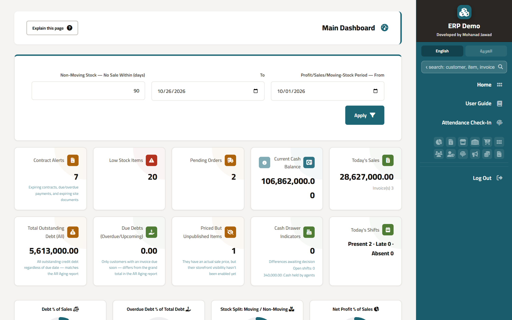
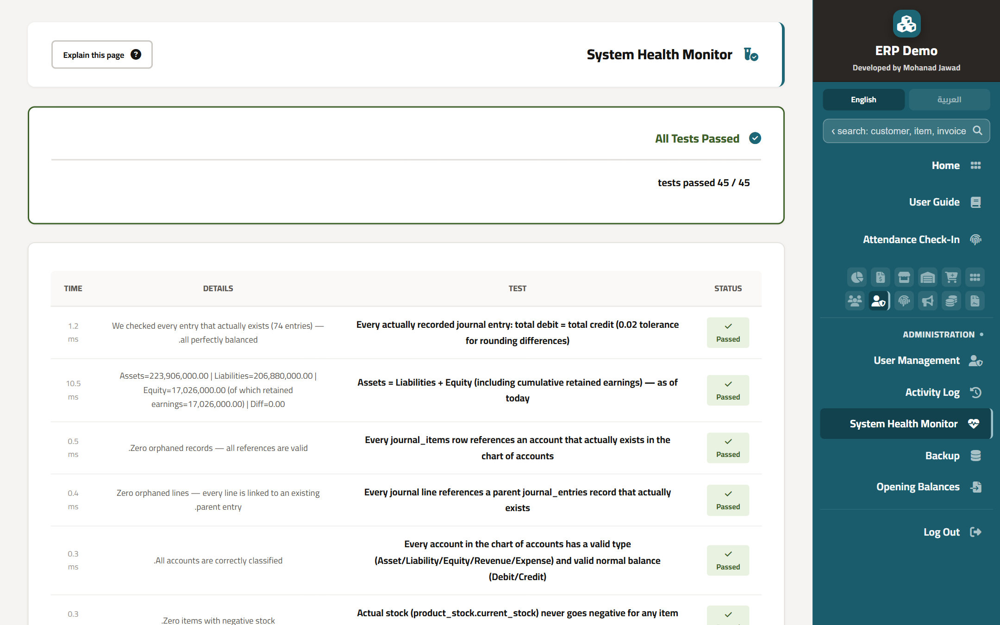
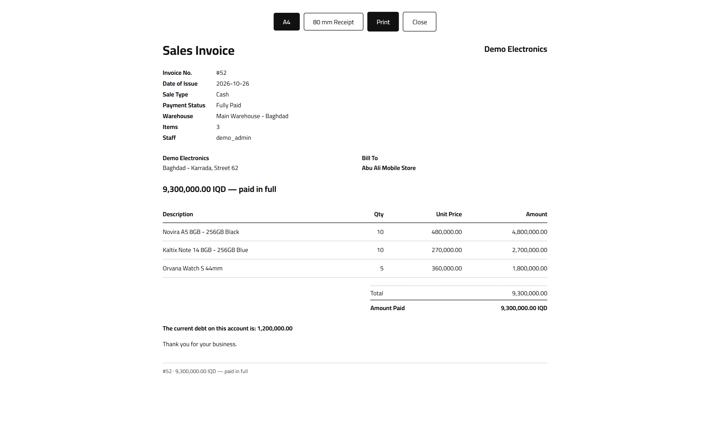
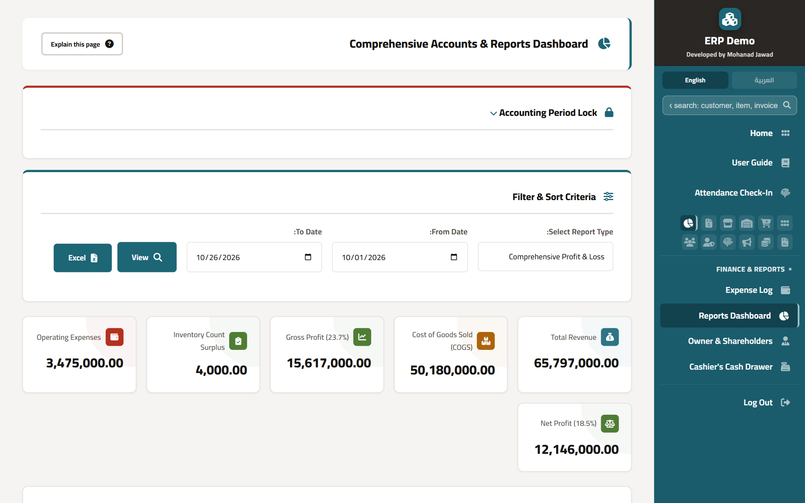
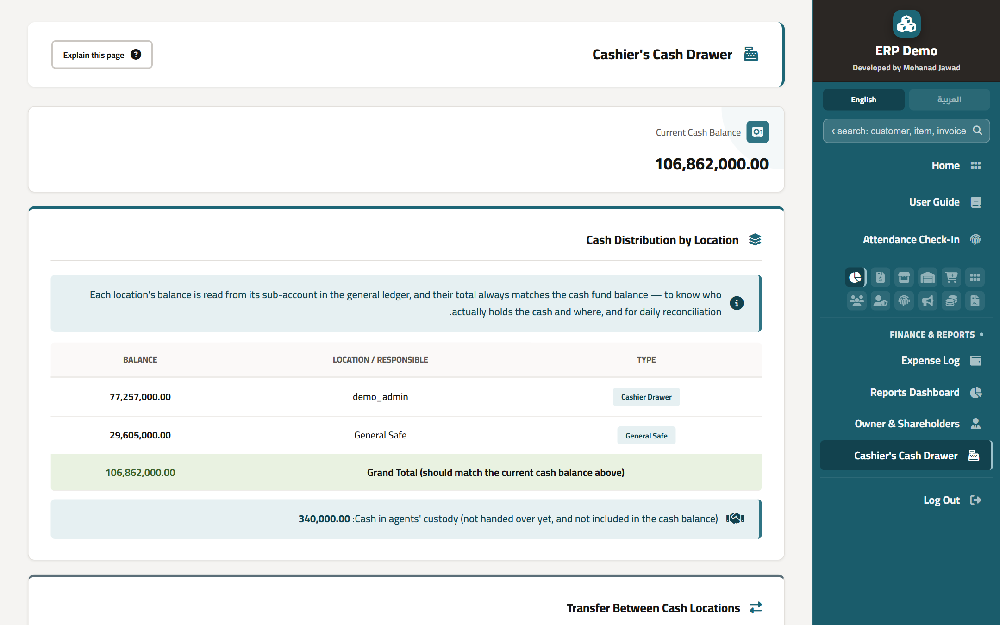
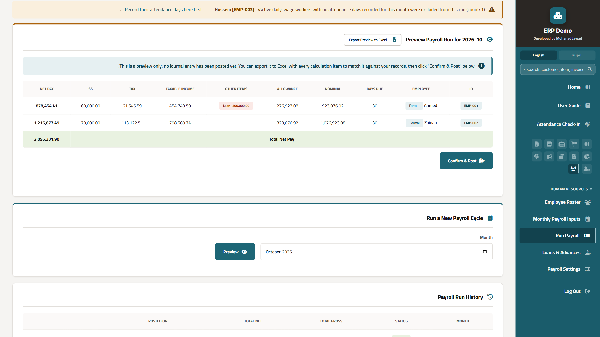
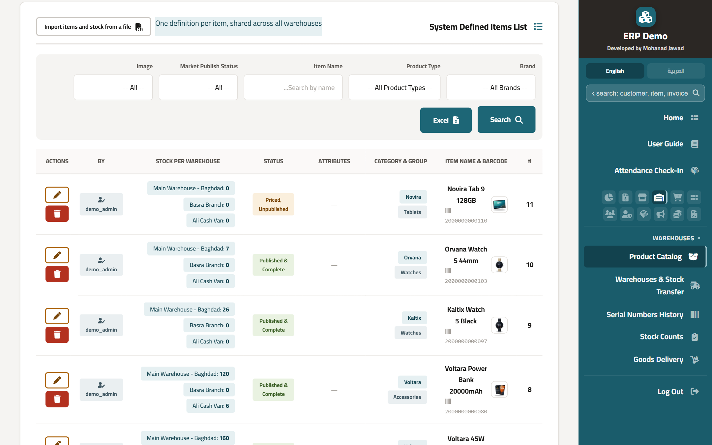
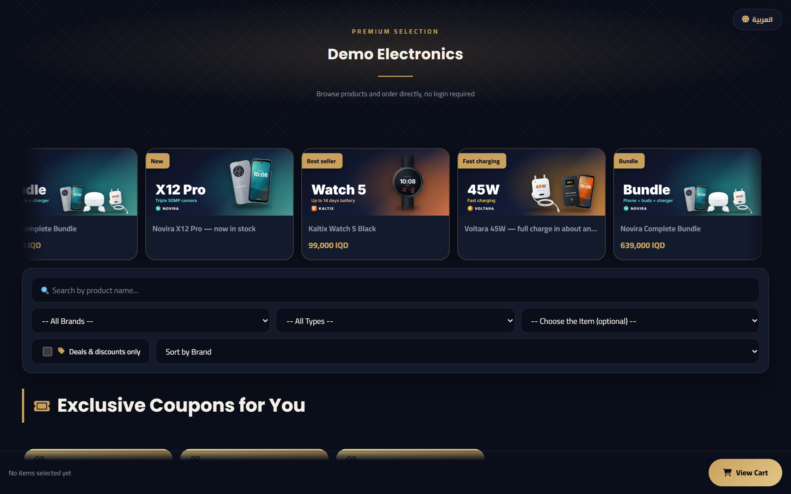
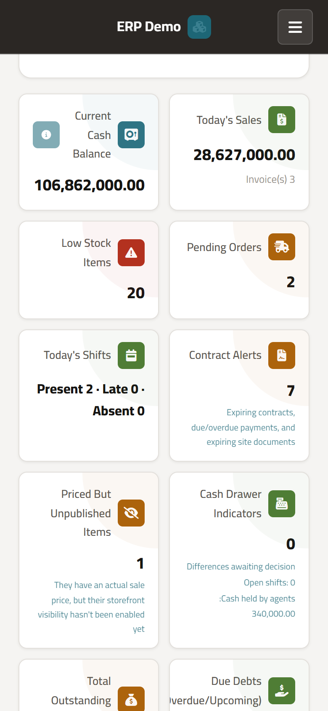

# ERP Demo

**A complete ERP system for trading businesses. Sales, stock, cash, accounting, payroll and an online store, all in one place.**

### [▶ Try the live demo](https://erp-demo.mohanadjawad.com/?src=github)

One click logs you in as an **admin**, a **sales employee** or a **sales agent**. All data is fictional and resets every hour, so feel free to try anything.

> The source code is private. This repository is a showcase only: screenshots, features and a link to the live demo.

---

## Why it's different

Most small-business systems record sales and stock, then leave the accounting to someone else. This one was designed by an auditor, so **the books are part of every action**:

- Every sale, purchase, return, expense and payment **posts its own journal entry**. The profit & loss, trial balance and balance sheet are always up to date.
- **45 automatic accounting checks** run on demand: debits equal credits, assets equal liabilities plus equity, stock never goes negative, the ledger matches the physical stock, and more.
- Cash is tracked **per location**: each cashier's drawer, each safe and each e-wallet has its own sub-account, so you always know who is holding the money.

---

## Features

### Sales & customers
- Cash and credit sales invoices with barcode scanning (including the phone camera)
- Serial number tracking from purchase to sale
- Quotations, product bundles and customer price lists
- Customer balances, statements and receivables aging
- Sales agents with their own points of sale and cash custody

### Purchasing & stock
- Purchase invoices, receiving (full or partial) and supplier returns
- Import costs (customs, shipping, clearance) spread across the items they belong to
- Multiple warehouses, stock transfers and weighted average cost
- Stock counts with variance approval
- Supplier balances and statements

### Cash & accounting
- Cashier shifts with blind counting and manager decisions on any difference
- Double-entry accounting with a full chart of accounts
- Manual journal vouchers with an approval workflow
- Period locking, opening balances for businesses moving from another system
- Reports: profit & loss, trial balance, balance sheet, cash flow, general ledger, and more, all exportable to Excel

### HR & payroll
- Employee records, monthly payroll with income tax and social security
- Loans and advances deducted from salaries
- GPS attendance check-in, shift planning and hours reports
- Sales commission plans with targets and bonuses

### Online store
- A storefront that sells from the same stock as the shop
- Brand pages, product galleries, banners and discount coupons
- Orders flow into the system and become invoices on delivery

---

## Screenshots

| | |
|---|---|
|  **Sales invoice** (A4 or 80 mm receipt) |  **Profit & loss** |
|  **Cash by location**, matched to the ledger |  **Payroll preview** with tax, social security and loans |
|  **Product catalog** with stock per warehouse |  **Online store** selling from the same stock |

 <b>On a phone</b>

---

## Built with

PHP 8 · MySQL / MariaDB · JavaScript · HTML & CSS

---

## About me

I'm Mohanad Jawad. I've spent 20 years in finance, from accounts payable and receivable to inventory, fixed assets, payroll and audit. I hold a B.Sc. in Computer Software Engineering, and I build systems that answer the questions an auditor would ask.

- LinkedIn: [linkedin.com/in/mohanad-jawad-bb62a436](https://www.linkedin.com/in/mohanad-jawad-bb62a436/)
- Live demo: [erp-demo.mohanadjawad.com](https://erp-demo.mohanadjawad.com/?src=github)
